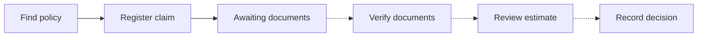

<p align="center">
  
</p>

<h1 align="center">Amana Takaful Motor Workflow</h1>

<p align="center"><strong>Motor policy lookup and claim tracking in one staff workspace</strong></p>

<p align="center">
  An academic prototype for Group O in CS304.3 Advanced Database Management Systems.
</p>

<p align="center">
  
  
  
  
</p>

<p align="center">
  <a href="#features">Features</a> &middot;
  <a href="#claim-workflow">Claim workflow</a> &middot;
  <a href="#run-locally">Run locally</a> &middot;
  <a href="#architecture">Architecture</a> &middot;
  <a href="#contributing">Contributing</a>
</p>

---

## Features

Staff can look up a synthetic motor policy, register a claim against its current policy period and reference version, and review the new claim in the **Staff work queue**. The queue supports stage filtering, and each claim opens a detail view with the incident description.

| Available in the prototype | Planned |
| --- | --- |
| Policy lookup, claim registration, stage filtering, and claim details | Policy renewals, document verification, estimate review, and claim decisions |
| In-memory synthetic policy and claim records | PostgreSQL persistence, staff access controls, audit history, reporting, and recovery |

## Claim workflow



A newly registered claim appears under **Awaiting documents**. Dotted arrows show planned transitions.

## Run locally

Install Node.js 24 and npm. From the repository root, install dependencies.

```sh
npm install
```

Start the API and web app in separate terminals.

| Terminal | Command | Local address |
| --- | --- | --- |
| API | `npm run dev:api` | `http://localhost:3001` |
| Web | `npm run dev:web` | Usually `http://localhost:5173` |

1. Open the URL printed by Vite and search for `DEMO-MOTOR-001`.
2. Enter an incident description and register the claim.
3. In the **Staff work queue**, select **Awaiting documents** and open the new claim number.

The demo runs without environment variables. Restarting the API clears registered claims. The planned PostgreSQL connection setting is documented in [the environment example](.env.example).

Run `npm run check` for TypeScript validation and `npm run build` for the production frontend build.

## Architecture

The React staff workspace calls the Express API, which stores demo records in memory. The planned PostgreSQL integration will persist policy and claim records.

| Path | Responsibility |
| --- | --- |
| `frontend/` | React workspace for policy lookup, claim intake, the work queue, and claim details |
| `backend/` | Express API and synthetic records |
| `shared/` | TypeScript contracts for policies and claims |
| `database/` | PostgreSQL handoff |
| `docs/` | API contract and integration notes |

[API contract](docs/api-contract.md) · [Database handoff](database/README.md)

## Contributing

Create a feature branch from `main` and open a pull request with verification steps. Coordinate schema changes with Thisandu and shared workflow changes with Chami. During integration, use the same synthetic claim to verify intake, document verification, estimate review, and the final decision.
